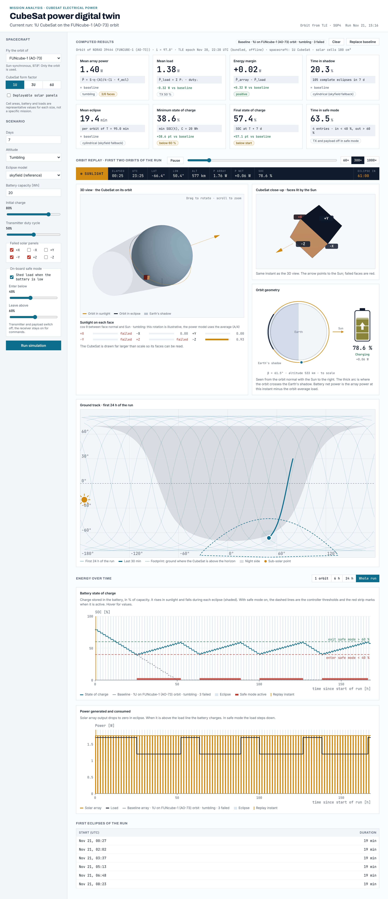
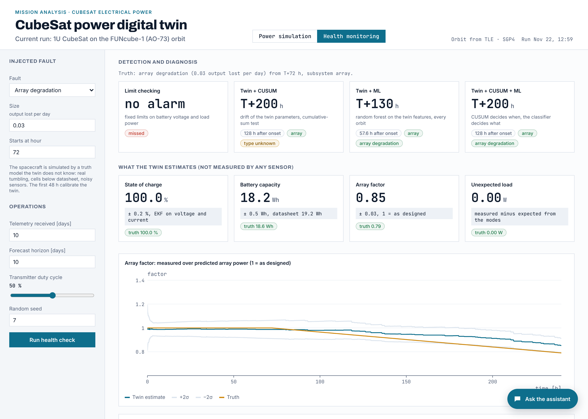
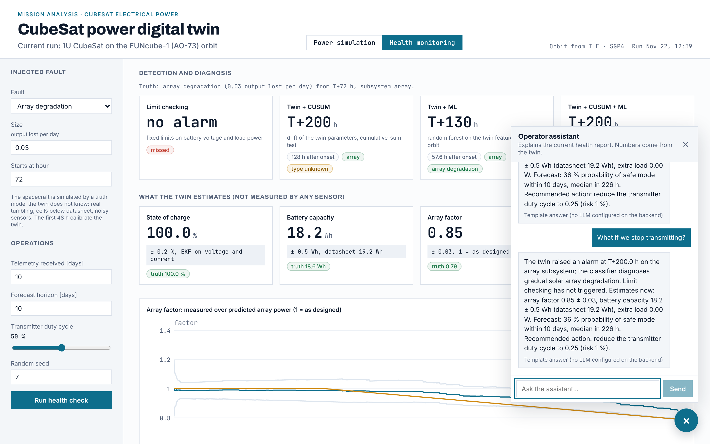
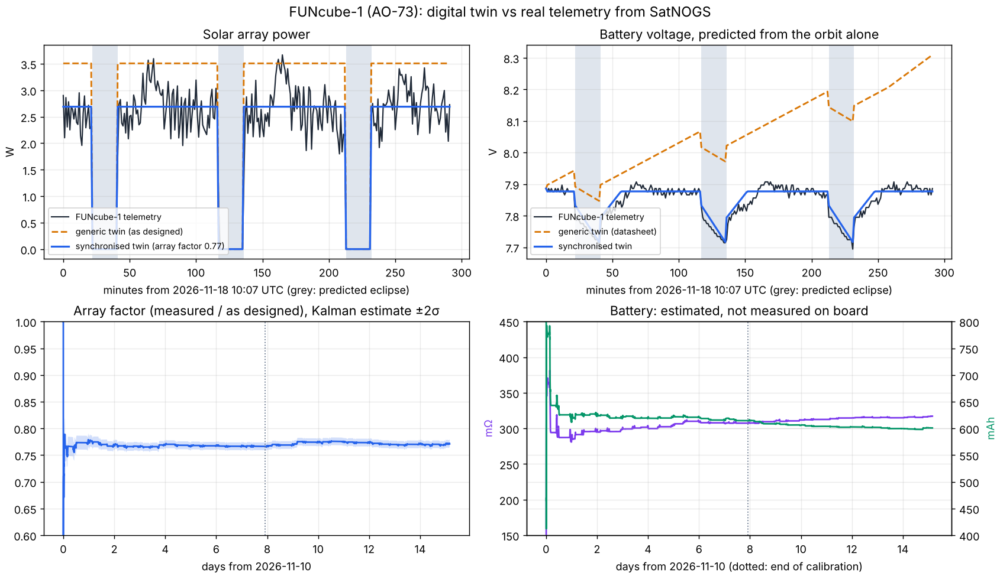
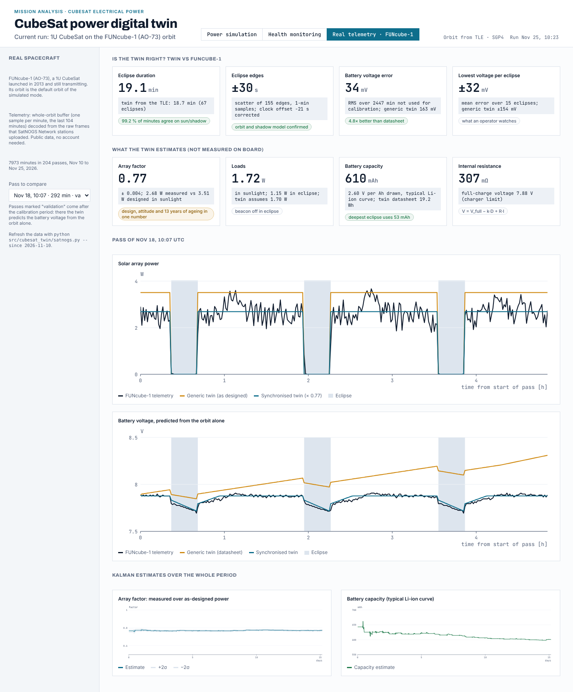
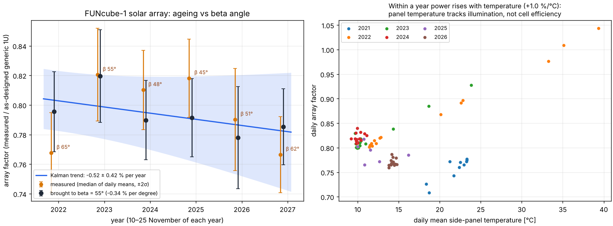

# CubeSat power digital twin

[](https://github.com/matildelucchesi/cubesat-power-twin/actions/workflows/ci.yml)

A digital twin of a CubeSat's electrical power system. It answers one question an operator
asks every day: **will the battery hold?** To answer it, the twin:

1. flies the CubeSat on a real orbit, propagated from published orbital elements;
2. finds when the spacecraft is in the Earth's shadow;
3. computes how much power the solar cells produce in sunlight;
4. subtracts what the subsystems consume and follows the battery charge over days;
5. optionally runs an on-board safe mode that switches loads off when the battery runs low;
6. keeps itself synchronised with telemetry, estimates what no sensor measures, detects and
   diagnoses faults, forecasts when the battery will reach safe mode and compares corrective
   actions ([health monitoring](#health-monitoring-from-simulator-to-digital-twin));
7. is checked against a real spacecraft: the telemetry that **FUNcube-1 (AO-73)** sent from
   orbit, received by SatNOGS ground stations
   ([real-data mode](#real-data-mode-the-twin-aligned-with-funcube-1)), including how much its
   solar array has aged from 2021 to 2026.

The program has two modes. The **simulated** mode (Power simulation and Health monitoring
views) flies a configurable CubeSat and generates its own telemetry. The **real-data** mode
(Real telemetry view, `real.py`) compares the twin with FUNcube-1's housekeeping data and
synchronises it.

A Python core does the physics, a FastAPI backend exposes it, and an Angular dashboard with a
Three.js 3D view lets you run what-if scenarios: a different CubeSat size, deployable solar
panels, solar-array failures (failed faces, a stuck wing, a lost string, radiation degradation),
another orbit, safe mode on or off.


## Why I built it

This digital twin started from my project for the **Laboratory of Automatic Control** exam,
[satellite-simulation](https://github.com/matildelucchesi/satellite-simulation). That project
simulates a satellite in orbit, including when it enters the Earth's shadow. Once eclipses were
there, I was curious about what they mean for the battery. How much energy is lost in the dark,
does the battery recover in sunlight, and what happens when something fails? So I developed the
project in that direction. I took the orbit and the eclipses as the starting point and built the
power system on top of them: solar array, loads, battery and safe mode. Then I made it a digital
twin, synchronised with telemetry, with fault detection, and checked against a real CubeSat.

## Contents

- [Why I built it](#why-i-built-it)
- [The physics, step by step](#the-physics-step-by-step)
- [Results](#results)
- [Health monitoring: from simulator to digital twin](#health-monitoring-from-simulator-to-digital-twin)
- [Real-data mode: the twin aligned with FUNcube-1](#real-data-mode-the-twin-aligned-with-funcube-1)
- [Using it as a study tool](#using-it-as-a-study-tool)
- [Software architecture](#software-architecture)
- [Run it](#run-it)
- [Model limits](#model-limits)
- [Physics or machine learning?](#physics-or-machine-learning)
- [How this was built](#how-this-was-built) · design notes in [DESIGN.md](DESIGN.md)

## The physics, step by step

### 1. Orbit: where is the spacecraft?

Satellite orbits are published as **TLEs** (two-line element sets): six orbital elements plus a
drag term, valid at a given *epoch*. The twin downloads the TLE from
[CelesTrak](https://celestrak.org) and propagates it with **SGP4**, the model the TLEs are made
for, through the [skyfield](https://rhodesmill.org/skyfield/) library. SGP4 includes the Earth's
oblateness and atmospheric drag; its error grows by a few kilometres a day away from the epoch,
so every run starts at the TLE epoch.

The output is the position every minute in the **GCRS** frame: centred on the Earth, with axes
fixed with respect to the stars. That frame is the natural one for lighting, because the Sun's
direction in it changes by only about 1° a day.

The default orbit is that of **FUNcube-1 (AO-73)**, a real 1U CubeSat on a sun-synchronous orbit
(97.8° inclination, 510–577 km altitude).

### 2. Eclipses: when is it in the dark?

The Sun direction comes from the low-precision solar formula of the *Astronomical Almanac*
(about 0.01° error). The Earth's shadow is modelled as a **cylinder** of the Earth's radius $R$
pointing away from the Sun. With $\hat{s}$ the unit vector to the Sun and $\vec{r}$ the
spacecraft position, the spacecraft is in shadow when

$$\vec{r}\cdot\hat{s} < 0 \quad\text{and}\quad \left|\vec{r} - (\vec{r}\cdot\hat{s})\,\hat{s}\right| < R$$

that is, when it is behind the Earth and closer to the Earth–Sun axis than one Earth radius.
skyfield's own `is_sunlit` (with the JPL DE421 ephemeris) is the cross-check:
`python src/cubesat_twin/eclipse.py` compares the two models. The cylinder ignores the penumbra,
the partial shadow that the spacecraft crosses in seconds at each eclipse entry and exit.


How long the eclipses last depends on the **beta angle** $\beta$: the angle between the Sun
direction and the orbit plane. At $\beta = 0$ the orbit cuts straight through the shadow and the
eclipse is longest; as $\beta$ grows the orbit passes the shadow off-centre. For a circular orbit
of altitude $h$ and period $T$ the eclipse lasts

$$t_{ecl} = \frac{T}{\pi}\arccos\!\left(\frac{\sqrt{h^2 + 2Rh}}{(R+h)\cos\beta}\right)$$

and above $\beta^{*} = \arcsin\!\big(R/(R+h)\big)$ there is no eclipse at all. On a
sun-synchronous orbit $\beta$ changes slowly over the seasons, so eclipse length is a seasonal
property of the orbit.


For FUNcube-1 in late November 2026, $\beta \approx 61°$. The formula gives 19.0 minutes, and the
full simulation gives 19.4 minutes per orbit, much shorter than the 35-minute maximum at this
altitude.

### 3. Solar power: how much does the array produce?

In sunlight a panel of cell area $A$ whose normal $\hat{n}$ makes an angle $\theta$ with the Sun
produces

$$P = S(t)\;\eta\;A\;\max(0, \cos\theta), \qquad \cos\theta = \hat{n}\cdot\hat{s}$$

- $S(t)$ is the solar irradiance: 1361 W/m² at 1 AU, corrected by ±3.3 % because the Earth's
  orbit is slightly elliptical (closest to the Sun in early January).
- $\eta = 0.28$ is the efficiency of triple-junction GaAs cells.
- The cell areas count whole 30.18 cm² cells per standard panel: 2 on a 10 × 10 cm face,
  7 on a 10 × 30 cm face, 14 on a 20 × 30 cm face.

The spacecraft orientation (**attitude**) decides the cosines. Two cases bracket reality:

- **Tumbling**: the CubeSat rotates randomly, as many do without active attitude control.
  Averaged over all directions, $\max(0,\cos\theta)$ is $1/4$ for any flat one-sided panel, so the
  mean useful area is the total cell area divided by 4.
- **Sun pointing**: the largest face (and any deployable panel) points straight at the Sun,
  $\cos\theta = 1$.

The 3D close-up shows the instantaneous $\cos\theta$ of each face, which is what the tumbling
average integrates over.


### 4. Battery: does the energy balance close?

Each time step $\Delta t$, the net power $P_{net} = P_{array} - P_{load}$ charges or discharges the
battery of capacity $C$:

$$E_{k+1} = \mathrm{clip}\Big(E_k + \Delta t \cdot \begin{cases} \eta_c\,P_{net} & P_{net} \ge 0 \\ P_{net}/\eta_d & P_{net} < 0 \end{cases},\; 0,\; C\Big), \qquad SOC = E/C$$

with charge efficiency $\eta_c = 0.90$ and discharge efficiency $\eta_d = 0.95$. When the battery
is full the surplus is dumped, as a real power system does with a shunt regulator.

The loads are orbit-average consumptions per subsystem (computer, power electronics, attitude
sensors, receiver, payload), with the transmitter weighted by its duty cycle. Batteries are packs
of 18650 Li-ion cells, 9.6 Wh each.

### 5. Safe mode: what does the spacecraft do when the battery runs low?

Real spacecraft protect the battery autonomously. The twin implements a **hysteresis controller**:

- below 40 % state of charge it enters safe mode and switches off the transmitter and the payload;
- it leaves safe mode only above 60 %.

Two thresholds instead of one avoid *chattering*: with a single threshold the spacecraft would
switch on and off at every small charge–discharge cycle around it. Because the load now depends on
the battery state, the battery and the controller are simulated together in a closed loop.

## Results

Seven days on FUNcube-1's orbit, 1U CubeSat with body-mounted cells, tumbling:

| Scenario | Mean power | Mean load | Battery |
| --- | --- | --- | --- |
| Nominal | 2.8 W | 1.7 W | never below 80 % |
| Three of six panels failed | 1.4 W | 1.7 W | empty after about 2 days |
| Four of six panels failed | 0.93 W | 1.7 W | empty after about 20 hours |
| Three failed, safe mode on | 1.4 W | 1.38 W | minimum 39 %; in safe mode 64 % of the week |

Safe mode turns a battery that would die into one that survives, at the cost of the transmitter
being off most of the time. That is the trade-off an operator has to judge.



Mean generated power for each size (7 days, same orbit):

| | Tumbling | Tumbling + wings | Sun pointing + wings |
| --- | --- | --- | --- |
| 1U | 2.8 W | 4.7 W | 9.4 W |
| 3U | 7.5 W | 14.1 W | 32.9 W |
| 6U | 11.8 W | 24.9 W | 65.8 W |

A 1U without deployables produces more power tumbling than sun pointing: its six faces collect
1.5 face-areas on average, while sun pointing shows only one face to the Sun.

## Health monitoring: from simulator to digital twin

A simulator runs from datasheet values. A digital twin is kept **synchronised with the real
spacecraft**, so it can reason about things the telemetry does not show directly. Spacecraft
health monitoring still relies mostly on fixed limits on telemetry channels. The **Health
monitoring** view of the dashboard and the modules below go one step further: detection,
diagnosis, prognosis and decision support on top of the synchronised twin.



### 1. Telemetry with known faults (`telemetry.py`)

Real CubeSat telemetry with labelled faults is hard to find, so a **truth model** plays the
spacecraft. It is deliberately richer than the twin, and the twin does not know its parameters:

- real tumbling about a random axis, so the array power swings with the angle of each face;
- battery cells 0 to 8 % below datasheet capacity, and an uncertain internal resistance;
- a transmitter switched on and off in blocks, plus the hysteresis safe mode;
- array curtailment: with a full battery the power system takes from the array only what the
  loads draw;
- sensor noise on every channel, and a battery voltage that follows a Li-ion open-circuit
  voltage curve.

It reports what an EPS reports: array power, load power, battery voltage and current, and the
transmitter and safe-mode flags. Faults are injected at a known time:

| Fault | What changes | Example |
| --- | --- | --- |
| `string_loss` | part or all of one face's cells stop producing | a broken cell string |
| `array_degradation` | array output drops by a fraction per day | radiation or contamination, accelerated |
| `capacity_fade` | battery capacity drops by a fraction per day | cell ageing, accelerated |
| `load_anomaly` | constant extra load | a heater stuck on |

### 2. Synchronisation and estimation (`estimation.py`)

Kalman filters keep the twin aligned with the telemetry, and estimate quantities that **no sensor
measures**, each with its uncertainty:

- **state of charge and battery capacity**: an extended Kalman filter on [SOC, 1/capacity].
  Integrating the current (coulomb counting) predicts how the SOC moves, and the voltage (through
  the open-circuit voltage curve) says where it really is. The mismatch between the two reveals
  the capacity;
- **array factor**: measured over predicted array power (1 = as designed). Only samples where
  the battery is clearly below full charge are used: when it is full the array is curtailed, and
  the measurement no longer says what the array could give;
- **load bias**: measured load minus the load expected from the reported modes.

### 3. Detection and diagnosis (`detection.py`)

Four methods run on the same telemetry, once per orbit:

1. **limit checking**, the classic approach: low battery voltage, high load power;
2. **twin + CUSUM**: a cumulative-sum test on the drift of the twin's parameters since a 48-hour
   calibration period, each drift divided by the filter's own uncertainty. The channel that
   alarms names the subsystem;
3. **twin + ML**: a random forest classifies each orbit from the twin's estimates and their trends,
   and names the fault type. A lost cell string and gradual degradation both lower the array
   factor, but the first one is a step and also changes the spread of the tumbling power, while
   the second one is a ramp;
4. **twin + CUSUM + ML**: the CUSUM decides *when* (few false alarms) and the classifier decides
   *what*.

`python src/cubesat_twin/health_benchmark.py 60` trains the classifier on 300 synthetic runs and
scores the methods on 150 other runs (different seeds, fault sizes and onset times; 12 days each,
fault sizes from barely visible to large):

| Method | Detected | False alarms | Median delay | Right subsystem | Right fault type |
| --- | --- | --- | --- | --- | --- |
| Limit checking | 18 % | 0 % | 1.2 h | 100 % | 100 % |
| Twin + CUSUM | 78 % | 1 % | 45.6 h | 98 % | - |
| Twin + ML | 76 % | 23 % | 27.4 h | 88 % | 82 % |
| **Twin + CUSUM + ML** | **78 %** | **1 %** | 45.6 h | **98 %** | **97 %** |

Limit checking only catches the larger stuck-on loads. The 1U CubeSat has a large power margin,
so a degrading array or a fading battery never pushes a channel past a limit until it is too late.
The twin sees all four fault types. The classifier alone reacts sooner but raises false alarms,
so the hybrid keeps the CUSUM's reliability and adds the classifier's diagnosis. The delay is
dominated by the slow faults (about 100 h for degradation of 1 to 4 % per day). Abrupt faults are
caught in hours: 2 h for a stuck load, 31 h median for a lost string.

### 4. Prognosis and decision (`prognosis.py`)

From the synchronised state and the recent trends of the array factor and capacity, a Monte Carlo
ensemble of forward runs on the predicted orbit gives the distribution of the **time left before
safe mode**. Because the truth model keeps running after the last telemetry sample, the forecast
can be checked. For 3 %/day array degradation starting at hour 72, the forecast made at day 10
gives a 36 % probability of safe mode within 10 days, with a median of 226 h. In the truth model
it happens after 216 h.

The same ensemble, rerun for lower transmitter duty cycles, closes the loop
detection → diagnosis → prognosis → action. The twin recommends the highest duty cycle (the most
data downlinked) whose risk of safe mode stays below 10 %; in that case, 25 %.

### 5. Operator assistant (`assistant.py`)

`POST /api/health/explain` gives the health report to Claude, which can call the twin's what-if
forecast as a tool, and returns a short explanation for the operator: what happened, how sure the
twin is, how much time is left and what to do. The numbers always come from the twin; the model
explains them and checks an action with a what-if run before recommending it. The loop is the plain
Messages API with one client tool, bounded to four rounds. It needs an Anthropic credential on the
backend (`ANTHROPIC_API_KEY` or an `ant auth login` profile). Without one, the endpoint answers with
a template explanation built from the same report.

In the dashboard the assistant is a floating chat: a button fixed at the bottom right of the Health
view opens it, with suggested questions and the conversation about the report on screen. A new
health check starts a new conversation.



## Real-data mode: the twin aligned with FUNcube-1

Everything above runs on synthetic telemetry: the twin can only show that it recovers parameters
we invented. This mode answers the harder question: **does the twin match a real spacecraft in
orbit, and what can it learn about it?**

### The data

[FUNcube-1 (AO-73)](https://funcube.org.uk/) is a 1U CubeSat built by AMSAT-UK and AMSAT-NL,
launched in November 2013 and still transmitting. It is the default orbit of the simulated mode.
Every 5 seconds it sends a 256-byte telemetry frame on 145.935 MHz (BPSK). Twelve of the 24 frame
types carry the **whole-orbit buffer**: one sample per minute for the last 104 minutes. A ground
station that hears a 10-minute pass therefore receives the whole previous orbit, eclipse included.

[SatNOGS Network](https://network.satnogs.org), the open network of amateur ground stations run by
the Libre Space Foundation, publishes the demodulated frames of every pass. No account or token
is needed. (The SatNOGS DB telemetry API needs a token and has no decoder for FUNcube-1, so the raw
frames are used instead.)

- `funcube.py` decodes the frames: bit-packed fields, following the FUNcube telemetry format as
  implemented in [gr-satellites](https://github.com/daniestevez/gr-satellites).
- `satnogs.py` downloads the frames of a date range, rebuilds the whole-orbit buffer of each pass,
  aligns overlapping passes from different stations and writes `data/real/funcube1_wholeorbit.csv`.
- The bundled snapshot covers **10 to 25 November 2026**: 5,338 frames from 116 passes, merged into
  **7,973 minutes** of telemetry in 204 contiguous stretches.

Per minute it gives the voltage of the X, Y and Z solar panels, the total array current, the battery
voltage, the system current and some temperatures. Both currents are measured on the battery bus,
so array power = bus voltage × array current, load power = bus voltage × system current.

### How the twin is aligned

| Step | What is compared or estimated | How | Result |
| --- | --- | --- | --- |
| Eclipses | 155 eclipse entries and exits in the telemetry (array current through half its sunlit level) against the shadow crossings predicted from the TLE | median difference = clock offset of the whole-orbit samples, applied from then on | offset −21 s, scatter ±30 s with 1-minute samples; sun/shadow agree on **99.2 %** of the minutes; eclipse 19.1 min measured vs 18.7 min predicted |
| Solar array | measured over as-designed array power, in sunlight away from eclipse edges | scalar Kalman filter (random walk) | **array factor 0.77 ± 0.004**: 2.68 W measured vs 3.51 W for the generic 1U in sunlight |
| Loads | system power in sunlight and in eclipse | two Kalman filters | 1.72 W in sunlight, **1.15 W in eclipse** (the telemetry beacon is off in the dark); the twin assumed 1.70 W always |
| Battery | voltage against the charge drawn | Kalman filter on [V_full, k, R], see below | full-charge voltage 7.88 V, **R = 0.31 Ω**, k = 2.6 V/Ah, **capacity ≈ 610 mAh** with a typical Li-ion curve |

**The battery model had to change.** FUNcube-1's power system stops charging at a fixed voltage
(about 7.88 V) and dumps the surplus, so the battery is full for most of the orbit, and its voltage
only moves during eclipse and recharge. The state is the **charge deficit** $D$ [Ah] below full,
from coulomb counting of the measured currents (reset to 0 when the voltage sits at the charger
limit in sunlight). The voltage is

$$V = V_{full} - k\,D + R\,I$$

and a Kalman filter estimates $V_{full}$ (slow random walk: it moves with temperature), $k$ (volts
lost per ampere-hour drawn) and $R$ (internal resistance). None of them is measured on board. If the
cells follow the twin's typical Li-ion open-circuit curve, $k$ gives the capacity
($C = \frac{dV_{oc}/dSOC}{k}$). The deepest eclipse draws 53 mAh, under 10 % of that capacity.

### Validation: predicting the battery from the orbit alone

The filters are run on **10–17 November** (calibration). The synchronised twin then predicts
**18–25 November** with no telemetry at all except the first voltage of each pass: sunlight and
array power come from the TLE, the loads and battery from the estimated parameters. The same
prediction with the generic datasheet twin (19.2 Wh, as-designed array, constant 1.7 W, battery free
to charge up to 8.4 V) is the baseline.

| On 17 passes, 2,447 minutes not used for calibration | Generic twin | Synchronised twin |
| --- | --- | --- |
| Battery voltage, RMS error | 163 mV | **34 mV** |
| Lowest voltage of each eclipse, mean error (15 eclipses) | 154 mV | **32 mV** |
| Array power in sunlight, RMS error | 0.92 W | 0.42 W |



What remains in the array power error is attitude: FUNcube-1's array power swings by about ±15 %
minute to minute as it rotates, and the twin only models the orbit average. The voltage residual is
mostly the 10 mV resolution of the telemetry and temperature effects the model leaves out.

What this says about the twin:

- **Orbit and eclipses are right.** SGP4 plus a cylindrical shadow predicts every eclipse within
  the 1-minute resolution of the data, and gets its length to 25 seconds (the cylinder ignores the
  penumbra, so real eclipses look slightly longer).
- **The generic spacecraft is not FUNcube-1**, and the data says how. The generic twin overestimates
  the array by 30 % (its cell area and attitude are not FUNcube-1's, plus 13 years of ageing), and its
  battery model misses the charge limit: in sunlight it keeps charging up to 8.4 V while the real
  battery stays at 7.88 V.
- **Fifteen days are too short to see ageing.** The array factor is flat over the period (0.77 ±
  0.004), so the twin cannot separate design differences from degradation. The next section repeats
  the measurement over six years.

In the dashboard, the **Real telemetry · FUNcube-1** view shows these checks, the estimates and,
for any pass, the real telemetry against both twins.



### Array ageing over six years (2021–2026)

FUNcube-1 was launched in November 2013. SatNOGS keeps decoded frames from 2021 onwards (older
passes are archived only as audio), so `degradation.py` repeats the measurement on the same dates,
**10–25 November of every year from 2021 to 2026**, and fits a trend. Using the same calendar dates
keeps the Earth–Sun distance nearly the same each year, and what is left is divided out by the
irradiance of the day.

Method:

1. **Daily array power.** The side-panel temperatures were added to the decoder, and every
   whole-orbit minute with the array in sunlight was used, except the 2 minutes around each eclipse
   edge. Each minute gives P = V_batt · I_array, and the minutes of each UTC day are averaged. Attitude
   makes single minutes swing by ±15 %, and whole days smooth that out. The repository keeps these
   daily aggregates (`data/real/funcube1_history_daily.csv`): 89 days and about 23,000 sunlit
   minutes.
2. **One value per year.** Each year's value is the median of its daily array factors (measured
   divided by as-designed). Its uncertainty comes from the day-to-day scatter.
3. **Kalman trend.** A filter on [level, rate per year, beta coefficient] takes in one year at a
   time. The beta angle, the angle between the Sun and the orbit plane, comes from each year's TLE
   (`funcube1_history_tles.txt`). A systematic floor is added to each year's variance until
   χ²/dof = 1.

| November | 2021 | 2022 | 2023 | 2024 | 2025 | 2026 |
| --- | --- | --- | --- | --- | --- | --- |
| Array factor (median) | 0.768 | 0.821 | 0.810 | 0.818 | 0.790 | 0.767 |
| Beta angle | 65° | 55° | 48° | 45° | 51° | 62° |
| Days with data | 10 | 14 | 15 | 15 | 6 | 15 |



What the data says:

- **The beta angle, not age, drives the year-to-year changes.** The array gives 0.34 ± 0.10 % less
  per degree of beta. 2021 and 2026, at similar beta (65° and 62°), have the same factor. The years
  near 45–55° are the highest.
- **Degradation is −0.5 ± 0.4 % per year**, or about −2.6 % in five years (±4.2 % at 2σ). This is
  not significant: the data rules out losses faster than about 1.4 %/yr, but cannot tell a small
  loss from none. Typical triple-junction GaAs in LEO loses 0.5–1 %/yr, which is consistent with
  the result.
- **Leaving out beta gives the wrong answer.** A plain straight line gives −0.3 ± 0.8 %/yr, with a
  scatter twice as large.
- **Panel temperature is not a usable correction here.** Within each year, days with warmer panels
  have *more* power (about +1 %/°C), the opposite of the cell coefficient (−0.25 %/°C). The side
  panels are warm when they are in the sun, so their temperature measures illumination, not cell
  efficiency. With the textbook 25 °C correction the rate would be −0.64 %/yr. It is reported only
  as a sensitivity check.

Limits: there is one two-week window per year, and 2025 has only 6 days. Beta is the only geometric
regressor, and attitude changes between years would look the same. The data before 2021, which
would cover the steepest early ageing, is not in SatNOGS.


## Using it as a study tool

The dashboard is built to compare scenarios, not to show a single case.

- **Orbit**: FUNcube-1 (sun-synchronous, 97.8°) is the reference: a real 1U CubeSat, and choosing
  it sets the form factor to 1U. The ISS (51.6°), Hubble (28.5°) or any NORAD number are what-if
  orbits: only their orbit is borrowed, and the simulated spacecraft is always the CubeSat you
  configure. The TLE is cached for a day, and a bundled
  FUNcube-1 TLE keeps the app working offline.
- **Form factor**: 1U, 3U or 6U body, with optional deployable panels (`configs/form_factors.yaml`).
- **Failure scenarios**: typical solar-array failures of small satellites, chosen from a list:
  one deployable wing stuck (drawn folded in the 3D view), an EPS channel lost (±X faces dark
  together), one cell string open on a face (half of +X), radiation degradation (−15 % on every
  cell). A custom option lets you pick which faces stop producing; the 3D model labels each face.
- **Baseline**: save a run as baseline; the next runs show the difference on every result card and
  overlay the baseline on the charts.
- **Safe mode**: switch it on and change the thresholds.
- **Real telemetry**: a third view switches from the simulated CubeSat to FUNcube-1. It shows
  the eclipse timing, the parameters the filters estimated and, for any pass, the real battery and
  array against the generic and synchronised twins.
- **Replay**: a progress bar, telemetry strip, 3D view, CubeSat close-up, to-scale orbit plane, battery gauge and
  live ground track all follow one clock (60×, 300× or 1000× real time).


## Software architecture

| Block | Module | What it does |
| --- | --- | --- |
| TLE | `tle.py` | CelesTrak download, one-day cache, bundled fallback |
| Orbit | `orbit.py` | SGP4 propagation with skyfield |
| Eclipses | `eclipse.py` | Sun direction, cylindrical shadow, eclipse list |
| Solar power | `power.py` | Irradiance, effective area per attitude |
| Loads | `loads.py` | Orbit-average consumption, safe-mode load set |
| Battery | `battery.py` | Energy balance with efficiencies |
| Safe mode | `safe_mode.py` | Hysteresis controller and closed-loop simulation |
| Simulation | `simulation.py` | Chains the blocks from a YAML configuration |
| Telemetry | `telemetry.py` | Truth model with tumbling, sensor noise and injected faults |
| Estimation | `estimation.py` | EKF for SOC and capacity, Kalman filters for array factor and load bias |
| Detection | `detection.py` | Limit checks, CUSUM on twin drifts, random-forest diagnosis, hybrid |
| Prognosis | `prognosis.py` | Monte Carlo forecast of the time to safe mode, duty-cycle study |
| Health | `health.py`, `health_benchmark.py` | End-to-end pipeline and benchmark on labelled runs |
| Assistant | `assistant.py` | Claude explains the health report, with the twin's what-if as a tool |
| Real data | `funcube.py`, `satnogs.py`, `real.py` | FUNcube-1 frame decoder, SatNOGS Network download, twin vs real telemetry: eclipse timing, Kalman filters, validation |
| Ageing | `degradation.py` | Array factor per year 2021–2026, Kalman trend with beta-angle regressor |
| API | `api.py` | FastAPI: `/api/simulate`, `/api/catalog`, `/api/config`, `/api/health`, `/api/health/explain`, `/api/health/benchmark`, `/api/real`; OpenAPI docs at `/docs` |
| Dashboard | `web/` | Angular (signals), hand-drawn SVG charts, Three.js 3D view |

All code is in `src/cubesat_twin/`, the tests in `tests/` (unit tests for each block and API
tests). GitHub Actions runs the tests and builds the dashboard on every push.
`docs/make_figures.py` regenerates the eclipse figures in this README.

## Run it

Developed on Ubuntu (WSL 2). Requires Python 3.10+ and Node 20+.

```bash
python3 -m venv .venv && source .venv/bin/activate
pip install -r requirements.txt
pytest -q                                  # unit and API tests

python src/cubesat_twin/simulation.py      # 7-day run: summary, results/simulation.csv, results/power_soc.png
python src/cubesat_twin/eclipse.py         # skyfield vs cylindrical eclipse model
python docs/make_figures.py                # README figures

python src/cubesat_twin/health_benchmark.py 60       # train the diagnosis model, score the four methods
python src/cubesat_twin/health.py array_degradation  # one fault end to end: alarms, estimates, prognosis

python src/cubesat_twin/real.py                       # real-data mode: twin vs FUNcube-1, docs/real-vs-twin.png
python src/cubesat_twin/satnogs.py --since 2026-11-10 # refresh the telemetry from SatNOGS (needs internet)
python src/cubesat_twin/degradation.py                # array ageing 2021-2026, docs/array-degradation.png
python src/cubesat_twin/satnogs.py --since 2023-11-10 --until 2023-11-26 --out data/real/2023  # one past year
```

Dashboard (two terminals):

```bash
# 1. backend
uvicorn api:app --app-dir src/cubesat_twin --reload    # http://localhost:8000/docs

# 2. frontend
cd web && npm install && npx ng serve                  # http://localhost:4200
```

## Model limits

- Spacecraft parameters are representative of commercial CubeSat parts, not of one mission.
- Attitude is either a tumbling average or ideal sun pointing; no attitude dynamics.
- Array ageing (2021–2026) rests on one two-week window per year and a single geometric
  regressor (beta angle); the trend of −0.5 ± 0.4 %/yr is not significant.
- The simulator has no temperature effects, cell degradation, Earth albedo or battery voltage
  model (the real-data mode measures some of them). Real 1U CubeSats without deployables
  typically average about 2 W, a little below the 2.8 W here.
- Loads are a constant average per mode; no ground-station passes.
- Safe mode sheds a fixed set of loads; there is no smarter load scheduling.
- Health monitoring (fault detection, diagnosis, prognosis) is evaluated on synthetic telemetry
  from a truth model; the real-data mode checks the twin itself on FUNcube-1, which had no fault in
  the period. The truth model is richer than the twin, but simpler than a real spacecraft
  (no temperature, no battery ageing within a day, no telemetry gaps). The faults are accelerated
  so that they show within days.
- Real-data mode: whole-orbit samples are 1 minute apart with 10 mV and 1 mA resolution; the battery
  capacity depends on the assumed open-circuit curve, since FUNcube-1's cell datasheet was not used;
  the clock offset is estimated, not known.
- The prognosis assumes a linear trend of the degradation it has seen; a fault that starts after
  the last telemetry sample is not foreseen.

## Physics or machine learning?

The physics model comes first: orbit, eclipses and panel geometry are well known, and a
physical model explains its results and extrapolates to unseen cases such as a failed panel.
The uncertain parts (cell temperature, degradation, real attitude and consumption) are where
data helps. The health-monitoring layer is that hybrid step. Kalman filters correct the physical
model with telemetry and estimate its unknown parameters. Machine learning works on the twin's
residuals and estimates rather than on raw telemetry, which is why it can tell a lost cell string
from gradual degradation. The real-data mode is the first step on real housekeeping telemetry: the
physics holds on FUNcube-1, and the filters turned a generic 1U into a twin of that spacecraft.
Followed over six Novembers, the same filters show that its array changes more with the beta angle
than with age. The next step is continuous monitoring: following the array factor and the battery
every week, so that the twin's health layer runs on real telemetry instead of synthetic faults.

## How this was built

I designed the twin: the physical models, the fault scenarios, the detection approach and the
validation strategy. The design notes, the alternatives I set aside and the limits of each result
are in [DESIGN.md](DESIGN.md).

I wrote the code together with an AI coding agent, Claude Code (its commits are marked as
co-authored in the history). My part in that loop was
**[TODO (Matilde): e.g. specifying each component, reviewing the generated code, writing or
checking the tests, and comparing the results against the physics and against real telemetry.
Keep only what is true, and add any other agent you used]**.

The main check on the result is external: the twin was calibrated and tested on real FUNcube-1
telemetry, decoded with the project's own decoder (`funcube.py`). On a week not used for
calibration it predicts the battery voltage with 34 mV RMS error, against 163 mV for a generic
datasheet model.

**Known limitations** are listed in [DESIGN.md § Limitations](DESIGN.md#6-limitations). The most
important is that the fault-detection benchmark uses faults injected into the project's own
simulator.
