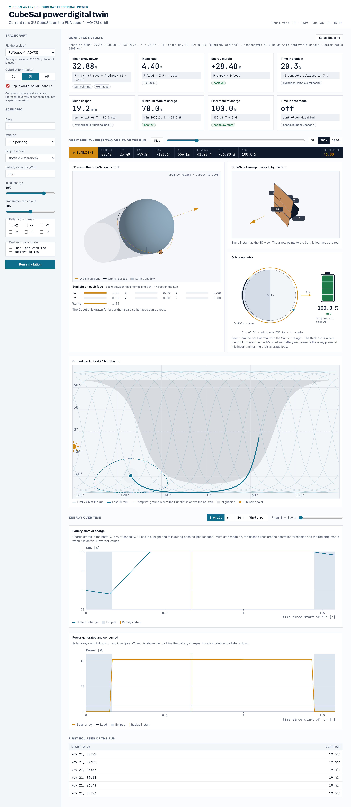
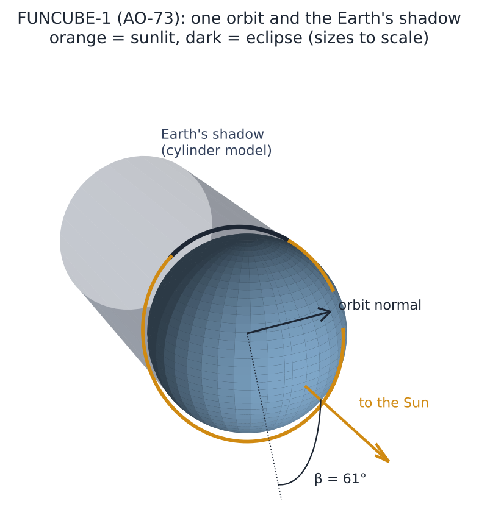
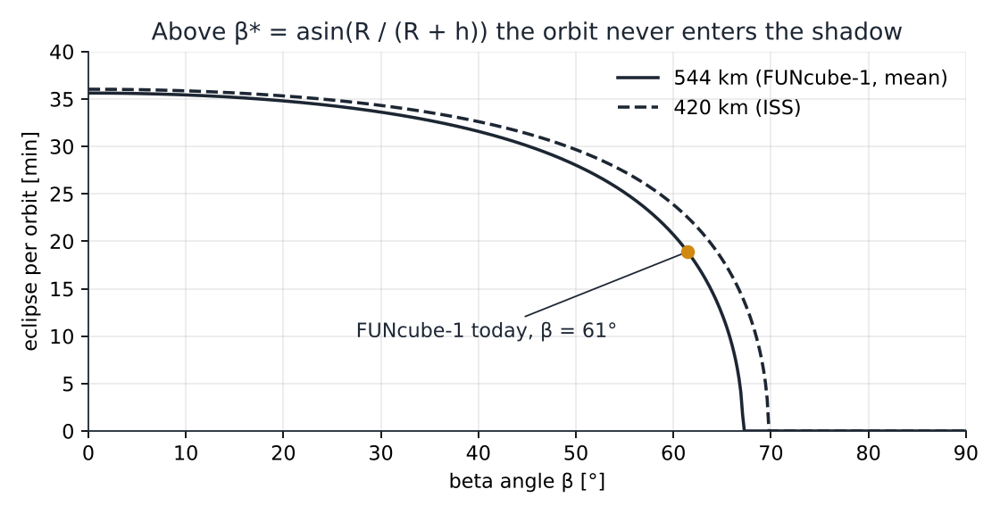
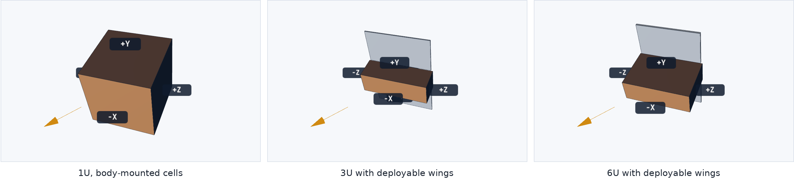
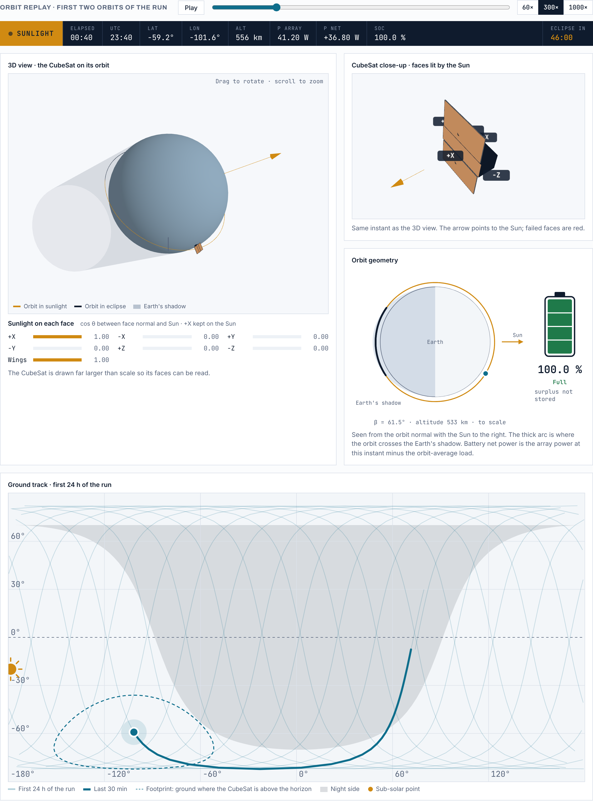

# CubeSat power digital twin

[](https://github.com/matildelucchesi/cubesat-power-twin/actions/workflows/ci.yml)

A digital twin of a CubeSat's electrical power system. It answers one question an operator
asks every day: **will the battery hold?** To answer it, the twin:

1. flies the CubeSat on a real orbit, propagated from published orbital elements;
2. finds when the spacecraft is in the Earth's shadow;
3. computes how much power the solar cells produce in sunlight;
4. subtracts what the subsystems consume and follows the battery charge over days;
5. optionally runs an on-board safe mode that switches loads off when the battery runs low.

A Python core does the physics, a FastAPI backend exposes it, and an Angular dashboard with a
Three.js 3D view lets you run what-if scenarios: a different CubeSat size, deployable solar
panels, failed panels, another orbit, safe mode on or off.



## Contents

- [The physics, step by step](#the-physics-step-by-step)
- [Results](#results)
- [Using it as a study tool](#using-it-as-a-study-tool)
- [Software architecture](#software-architecture)
- [Run it](#run-it)
- [Model limits](#model-limits)
- [Physics or machine learning?](#physics-or-machine-learning)

## The physics, step by step

### 1. Orbit: where is the spacecraft?

Satellite orbits are published as **TLEs** (two-line element sets): six orbital elements plus a
drag term, valid at a given *epoch*. The twin downloads the TLE from
[CelesTrak](https://celestrak.org) and propagates it with **SGP4**, the model the TLEs are made
for, through the [skyfield](https://rhodesmill.org/skyfield/) library. SGP4 includes the Earth's
oblateness and atmospheric drag; its error grows by a few kilometres a day away from the epoch,
so every run starts at the TLE epoch.

The output is the position every minute in the **GCRS** frame: centred on the Earth, with axes
fixed with respect to the stars. That frame is the natural one for lighting, because the Sun's
direction in it changes by only about 1° a day.

The default orbit is that of **FUNcube-1 (AO-73)**, a real 1U CubeSat on a sun-synchronous orbit
(97.8° inclination, 510–577 km altitude).

### 2. Eclipses: when is it in the dark?

The Sun direction comes from the low-precision solar formula of the *Astronomical Almanac*
(about 0.01° error). The Earth's shadow is modelled as a **cylinder** of the Earth's radius $R$
pointing away from the Sun. With $\hat{s}$ the unit vector to the Sun and $\vec{r}$ the
spacecraft position, the spacecraft is in shadow when

$$\vec{r}\cdot\hat{s} < 0 \quad\text{and}\quad \left|\vec{r} - (\vec{r}\cdot\hat{s})\,\hat{s}\right| < R$$

that is, when it is behind the Earth and closer to the Earth–Sun axis than one Earth radius.
skyfield's own `is_sunlit` (with the JPL DE421 ephemeris) is the cross-check:
`python src/cubesat_twin/eclipse.py` compares the two models. The cylinder ignores the penumbra,
the partial shadow that the spacecraft crosses in seconds at each eclipse entry and exit.



How long the eclipses last depends on the **beta angle** $\beta$: the angle between the Sun
direction and the orbit plane. At $\beta = 0$ the orbit cuts straight through the shadow and the
eclipse is longest; as $\beta$ grows the orbit passes the shadow off-centre. For a circular orbit
of altitude $h$ and period $T$ the eclipse lasts

$$t_{ecl} = \frac{T}{\pi}\arccos\!\left(\frac{\sqrt{h^2 + 2Rh}}{(R+h)\cos\beta}\right)$$

and above $\beta^{*} = \arcsin\!\big(R/(R+h)\big)$ there is no eclipse at all. On a
sun-synchronous orbit $\beta$ changes slowly over the seasons, so eclipse length is a seasonal
property of the orbit.



For FUNcube-1 in late November 2026, $\beta \approx 61°$. The formula gives 19.0 minutes, and the
full simulation gives 19.4 minutes per orbit, much shorter than the 35-minute maximum at this
altitude.

### 3. Solar power: how much does the array produce?

In sunlight a panel of cell area $A$ whose normal $\hat{n}$ makes an angle $\theta$ with the Sun
produces

$$P = S(t)\;\eta\;A\;\max(0, \cos\theta), \qquad \cos\theta = \hat{n}\cdot\hat{s}$$

- $S(t)$ is the solar irradiance: 1361 W/m² at 1 AU, corrected by ±3.3 % because the Earth's
  orbit is slightly elliptical (closest to the Sun in early January).
- $\eta = 0.28$ is the efficiency of triple-junction GaAs cells.
- The cell areas count whole 30.18 cm² cells per standard panel: 2 on a 10 × 10 cm face,
  7 on a 10 × 30 cm face, 14 on a 20 × 30 cm face.

The spacecraft orientation (**attitude**) decides the cosines. Two cases bracket reality:

- **Tumbling**: the CubeSat rotates randomly, as many do without active attitude control.
  Averaged over all directions, $\max(0,\cos\theta)$ is $1/4$ for any flat one-sided panel, so the
  mean useful area is the total cell area divided by 4.
- **Sun pointing**: the largest face (and any deployable panel) points straight at the Sun,
  $\cos\theta = 1$.

The 3D close-up shows the instantaneous $\cos\theta$ of each face, which is what the tumbling
average integrates over.



### 4. Battery: does the energy balance close?

Each time step $\Delta t$, the net power $P_{net} = P_{array} - P_{load}$ charges or discharges the
battery of capacity $C$:

$$E_{k+1} = \mathrm{clip}\Big(E_k + \Delta t \cdot \begin{cases} \eta_c\,P_{net} & P_{net} \ge 0 \\ P_{net}/\eta_d & P_{net} < 0 \end{cases},\; 0,\; C\Big), \qquad SOC = E/C$$

with charge efficiency $\eta_c = 0.90$ and discharge efficiency $\eta_d = 0.95$. When the battery
is full the surplus is dumped, as a real power system does with a shunt regulator.

The loads are orbit-average consumptions per subsystem (computer, power electronics, attitude
sensors, receiver, payload), with the transmitter weighted by its duty cycle. Batteries are packs
of 18650 Li-ion cells, 9.6 Wh each.

### 5. Safe mode: what does the spacecraft do when the battery runs low?

Real spacecraft protect the battery autonomously. The twin implements a **hysteresis controller**:

- below 40 % state of charge it enters safe mode and switches off the transmitter and the payload;
- it leaves safe mode only above 60 %.

Two thresholds instead of one avoid *chattering*: with a single threshold the spacecraft would
switch on and off at every small charge–discharge cycle around it. Because the load now depends on
the battery state, the battery and the controller are simulated together in a closed loop.

## Results

Seven days on FUNcube-1's orbit, 1U CubeSat with body-mounted cells, tumbling:

| Scenario | Mean power | Mean load | Battery |
| --- | --- | --- | --- |
| Nominal | 2.8 W | 1.7 W | never below 80 % |
| Three of six panels failed | 1.4 W | 1.7 W | empty after about 2 days |
| Four of six panels failed | 0.93 W | 1.7 W | empty after about 20 hours |
| Three failed, safe mode on | 1.4 W | 1.38 W | minimum 39 %; in safe mode 64 % of the week |

Safe mode turns a battery that would die into one that survives, at the cost of the transmitter
being off most of the time. That is the trade-off an operator has to judge.


Mean generated power for each size (7 days, same orbit):

| | Tumbling | Tumbling + wings | Sun pointing + wings |
| --- | --- | --- | --- |
| 1U | 2.8 W | 4.7 W | 9.4 W |
| 3U | 7.5 W | 14.1 W | 32.9 W |
| 6U | 11.8 W | 24.9 W | 65.8 W |

A 1U without deployables produces more power tumbling than sun pointing: its six faces collect
1.5 face-areas on average, while sun pointing shows only one face to the Sun.

## Using it as a study tool

The dashboard is built to compare scenarios, not to show a single case.

- **Orbit**: fly the CubeSat on the orbit of a preset object (FUNcube-1, sun-synchronous at 97.8°;
  the ISS, 51.6°; Hubble, 28.5°) or of any NORAD number. Only the orbit is borrowed: the simulated
  spacecraft is always the CubeSat you configure. The TLE is cached for a day, and a bundled
  FUNcube-1 TLE keeps the app working offline.
- **Form factor**: 1U, 3U or 6U body, with optional deployable panels (`configs/form_factors.yaml`).
- **Failed panels**: pick which faces stop producing; the 3D model labels each face.
- **Baseline**: save a run as baseline; the next runs show the difference on every result card and
  overlay the baseline on the charts.
- **Safe mode**: switch it on and change the thresholds.
- **Replay**: telemetry strip, 3D view, CubeSat close-up, to-scale orbit plane, battery gauge and
  live ground track all follow one clock (60×, 300× or 1000× real time).



## Software architecture

| Block | Module | What it does |
| --- | --- | --- |
| TLE | `tle.py` | CelesTrak download, one-day cache, bundled fallback |
| Orbit | `orbit.py` | SGP4 propagation with skyfield |
| Eclipses | `eclipse.py` | Sun direction, cylindrical shadow, eclipse list |
| Solar power | `power.py` | Irradiance, effective area per attitude |
| Loads | `loads.py` | Orbit-average consumption, safe-mode load set |
| Battery | `battery.py` | Energy balance with efficiencies |
| Safe mode | `safe_mode.py` | Hysteresis controller and closed-loop simulation |
| Simulation | `simulation.py` | Chains the blocks from a YAML configuration |
| API | `api.py` | FastAPI: `/api/simulate`, `/api/catalog`, `/api/config`; OpenAPI docs at `/docs` |
| Dashboard | `web/` | Angular (signals), hand-drawn SVG charts, Three.js 3D view |

All code is in `src/cubesat_twin/`, the tests in `tests/` (unit tests for each block and API
tests). GitHub Actions runs the tests and builds the dashboard on every push.
`docs/make_figures.py` regenerates the eclipse figures in this README.

## Run it

Developed on Ubuntu (WSL 2). Requires Python 3.10+ and Node 20+.

```bash
python3 -m venv .venv && source .venv/bin/activate
pip install -r requirements.txt
pytest -q                                  # unit and API tests

python src/cubesat_twin/simulation.py      # 7-day run: summary, results/simulation.csv, results/power_soc.png
python src/cubesat_twin/eclipse.py         # skyfield vs cylindrical eclipse model
python docs/make_figures.py                # README figures
```

Dashboard (two terminals):

```bash
# 1. backend
uvicorn api:app --app-dir src/cubesat_twin --reload    # http://localhost:8000/docs

# 2. frontend
cd web && npm install && npx ng serve                  # http://localhost:4200
```

## Model limits

- Spacecraft parameters are representative of commercial CubeSat parts, not of one mission.
- Attitude is either a tumbling average or ideal sun pointing; no attitude dynamics.
- No temperature effects, cell degradation, Earth albedo or battery voltage model. Real 1U
  CubeSats without deployables typically average about 2 W, a little below the 2.8 W here.
- Loads are a constant average per mode; no ground-station passes.
- Safe mode sheds a fixed set of loads; there is no smarter load scheduling.

## Physics or machine learning?

The physics model comes first: orbit, eclipses and panel geometry are well known, and a
physical model explains its results and extrapolates to unseen cases such as a failed panel.
The uncertain parts (cell temperature, degradation, real attitude and consumption) are where
a data-driven correction trained on real telemetry could reduce the residual error. That
hybrid step is planned once telemetry is available.
